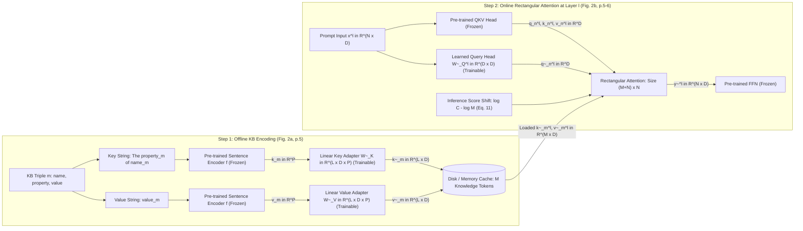

# KBLaM: Knowledge Base augmented Language Model — 연구 분석 보고서

> **논문 정보**: Xi Wang, Taketomo Isazawa, Liana Mikaelyan, James Hensman | `arxiv:2410.10450` (2024-10-14, ICLR 2025)
> **TL;DR**: KBLaM은 외부 지식 통합 시 Fine-tuning의 Catastrophic Forgetting 및 갱신 비효율성, RAG의 외부 Retriever 의존성, 그리고 In-Context Learning (ICL)의 $O(N^2)$ 연산·메모리 복잡도 병목을 해결하기 위해 제안된 프레임워크이다(pp.1–2). Pre-trained Sentence Encoder와 Linear Adapter로 Knowledge Triple을 연속적 Key-Value 벡터 쌍(Knowledge Token)으로 변환하고, 이를 Rectangular Attention 구조로 LLM에 독립 주입함으로써 KB 크기에 대해 선형($O(M)$) 복잡도와 재학습 없는 동적 업데이트를 달성한다(pp.1–2, pp.4–6, Fig. 1). 이를 통해 단일 A100 80GB GPU 환경에서 8K context window를 가진 Llama3 8B 모델에 10K 이상의 Triples를 통합하였으며, QA 및 Open-ended Reasoning 태스크에서 효과성과 해석 가능성을 입증하였다(p.1, p.8).
> **표기 규칙**: 본문/표에 명시된 수치는 그대로 표기하며, 그래프(Plot)에서 판독한 근사 수치는 `~`를 붙여 구분함.

---

## 1. Overview

* **핵심 아이디어**: 비정형 문서 코퍼스를 `(<name>, <property>, <value>)` 형태의 구조화된 Knowledge Base (KB)로 변환한 뒤(Eq. (1), p.3), 각 Triple을 가변 길이 문자열 대신 LLM 단일 토큰의 Key-Value (KV) Cache와 동일한 차원 $D$를 갖는 연속적 벡터 쌍(**Knowledge Token**)으로 압축하여 Transformer의 각 Attention Layer에 직접 주입한다(pp.1–2, pp.4–5).
* **동작 흐름 (2-Stage Pipeline)**:
  1. **Offline KB Encoding (Step 1)**: 가중치가 동결(frozen)된 Pre-trained Sentence Encoder $f(\cdot)$로 Key 문자열(`The <property>_m of <name>_m`)과 Value 문자열(`<value>_m`)을 $P$차원 임베딩으로 변환한 뒤, 학습 가능한 Linear Adapter $\tilde{\boldsymbol{W}}_K, \tilde{\boldsymbol{W}}_V \in \mathbb{R}^{L \times D \times P}$를 통해 LLM의 $L$개 레이어별 $D$차원 KV 공간으로 사상하여 디스크에 저장한다(Eqs. (4)–(7), pp.4–5, Fig. 2a).
  2. **Online Rectangular Attention (Step 2)**: 추론 시 길이 $N$의 Prompt 토큰이 이전 Prompt 토큰(Causal Self-Attention)과 $M$개의 Knowledge Token(Non-causal Lookup)에 동시에 Attend하는 $(M+N) \times N$ 직사각형 Attention을 수행하되, Knowledge Token 간 상호 Attention은 배제한다(Eqs. (9)–(10), pp.5–6, Fig. 2b). Base LLM 파라미터 $\phi$는 완전히 동결하고 Adapter와 KB 전용 Query Head $\theta$만 Synthetic KB 기반 Instruction Tuning으로 학습한다(Eq. (12), pp.6–7).
* **주요 정량적 달성치**:
  * **메모리 확장성**: 단일 80GB A100 GPU에서 8K context window를 가진 Llama3 8B 모델 기준, In-Context Learning (ICL)이 메모리 한계(`~78–80 GB`, Fig. 3, p.6)로 최대 200 Triples까지만 수용한 반면(p.8), KBLaM은 `10K` 이상(`10^4`) Triples를 `~28–30 GB` 내외로 통합하였다(p.1, p.6 Fig. 3, p.8).
  * **Latency & Memory vs. RAG**: Retriever 지연시간을 0으로 가정한 이상적인 RAG ($K=5$ Triples 검색)와 비교 시, KBLaM은 KB 크기(`2^0`~`2^12` Triples)와 무관하게 `~0.041–0.043 s`의 일정한 Time to First Token (TTFT)을 유지해 RAG (`~0.048 s`)보다 빠르며, `512` Triples(`2^9`) 지점에서 RAG (`~18.25 GB`)와 동일한 메모리를 사용한다(Appendix C, pp.16–17, Fig. 11).
  * **Implicit Retrieval & QA 성능**: 별도의 Retrieval 정규화 손실 없이도 15th Layer의 Head-averaged Attention Score만으로 Synthetic KB에서 Top-1 `~0.98 → ~0.83`, Top-5 `~1.00 → ~0.96` 정확도를 기록하였고(p.9, Fig. 5), Synthetic Q&A에서 ICL에 근접한 BERTScore F1(`~0.92 → ~0.76` vs. ICL `~0.96`, p.10, Fig. 6a)을 달성하였다.
* **기존 대비 핵심 차별점**:
  * **vs. Fine-tuning (SFT / LoRA)**: 모델 가중치 $\phi$를 수정하지 않아 Catastrophic Forgetting 및 데이터 암기(Memorization)를 억제하며, 지식 갱신 시 재학습이 불필요하다(p.1, pp.6–7).
  * **vs. RAG**: 추론 시 외부 Retriever 모듈 없이 단일 모델 내에서 End-to-End Soft Retrieval을 수행하며, 검색된 이산 문자열 연결에 따른 Prompt 팽창을 피한다(pp.1–3, Fig. 1).
  * **vs. ICL & Standard KV Cache**: Attention 복잡도를 $O((KM)^2)$에서 $O(M)$으로 낮추고 FFN 연산량($O(ND^2)$)을 $M$에 대해 불변으로 유지하며, Triple 간 독립성 덕분에 수정 시 전체 캐시 재계산 없이 해당 Knowledge Token만 교체할 수 있고 Positional Bias를 원천 차단한다(pp.3–6).

---

## 2. Background & Related Works

외부 지식을 Pre-trained LLM에 통합하는 기존 접근법들은 크게 파라미터 기반 학습(Fine-tuning), 비파라미터 문자열 삽입(RAG, ICL), 그리고 구조화된 Attention 및 연속 벡터 메모리 기법으로 분류된다(pp.1–3, Appendix A p.14).

| 패러다임 | 동작 방식 | 장점 | 구조적 한계 |
| :--- | :--- | :--- | :--- |
| **Supervised Fine-Tuning / LoRA** (Hu et al., 2021; Liu et al., 2024c) | 외부 코퍼스에 대해 LLM 파라미터 또는 저차원 어댑터 가중치를 직접 업데이트(p.1) | 추론 시 추가 Context 길이 오버헤드 없음 | 지식 갱신마다 재학습 필요, 일반 태스크 성능 저하(Catastrophic Forgetting), 학습 데이터 암기(Memorization) 위험(p.1, p.7) |
| **RAG** (Lewis et al., 2020; Qin et al., 2022) | 외부 Retriever(예: Similarity Search, Text2SQL)가 관련 청크를 검색해 Prompt에 문자열로 연결(p.1, p.3) | 대규모 외부 문서 처리에 용이하며 Context 크기를 작게 유지 가능(p.1) | 별도 외부 Retriever 모듈에 의존해 파이프라인 분리, 검색 문자열 길이에 따른 Latency/Memory 오버헤드 발생(pp.1–3, pp.16–17) |
| **In-Context Learning (ICL)** (Lee et al., 2024; Li et al., 2024a 등) | 외부 코퍼스 전체를 텍스트로 평탄화하여 Long-context LLM의 입력에 직접 삽입(pp.1–2, p.8) | 단일 컴포넌트 End-to-End 추론, CoT 및 Few-shot과 높은 호환성(pp.1–2) | Context 길이에 대해 Self-Attention 시간·메모리 복잡도가 $O(N^2)$로 폭증, Positional Bias, 부분 수정 시 KV Cache 재계산 필요(p.2, p.6) |
| **Structured Attention** (Ratner et al., 2022; Cai et al., 2023; Merth et al., 2024) | Lower-triangular Causal Mask 대신 독립적인 세그먼트(Few-shot 예시, 이종 문서) 간 Attention을 차단(p.3) | 독립성 가정을 활용해 Context 내 불필요한 Attention 연산 절감(p.3) | 원문 토큰 시퀀스를 그대로 유지하므로 KBLAM처럼 Triple을 단일 토큰 크기 연속 벡터로 압축·주입하지 못함(p.3) |
| **Memory-Augmented & Continuous Augmentation** (Wu et al., 2022; RETRO; FiD; Yen et al., 2024) | 외부 메모리/문서를 연속 KV 벡터 쌍으로 저장하거나 별도 Encoder 및 Cross-Attention Layer로 주입(p.14) | 이산 토큰 대비 압축된 연속 표현 활용 가능 | Transformer나 Encoder를 처음부터 학습해야 하거나 각 Self-Attention Layer 뒤에 별도 Cross-Attention Layer 추가 필요(Appendix A, p.14) |
| **KBLAM (Ours)** | Frozen Black-box Sentence Encoder + Linear Adapter로 Triple을 Knowledge Token화하고 Rectangular Attention으로 주입(pp.4–6) | $O(M)$ 선형 확장, FFN 불변, $O(1)$ 동적 업데이트, Positional Bias 제거, Base LLM 동결(pp.2–6) | Triple 사전 추출 의존, 고정 길이 압축으로 인한 정밀 문자열/수치 손실, OOD(Enron) 성능 하락(pp.9–10, p.16) |

### 카테고리별 관련 연구와 KBLAM의 위치
* **RAG와의 연결점**: KBLAM은 Prompt의 Query와 Knowledge Token의 Key 간 내적 유사도로 Value의 가중 평균을 구한다는 점에서 Attention 내부의 **Implicit Soft Retrieval**로 해석할 수 있으나, 별도 Retriever 없이 단일 모델 내에서 End-to-End로 동작한다(Sec. 2, p.3).
* **Standard KV Cache (Pope et al., 2023)와의 차이**: KV Cache는 Prefill 이후 생성 복잡도를 선형으로 낮추지만 Causal Attention Mask 의존성 때문에 문맥이 일부만 수정되어도 전체 캐시를 재계산해야 한다(p.3, p.6). 반면 KBLAM은 외부 Encoder로 각 Knowledge Token을 독립 생성하므로 수정된 Triple만 교체하면 된다(p.3, p.6).
* **Continuous Knowledge & Multi-modal Adapter (Liu et al., 2023 등)**: KBLAM은 외부 KB를 또 하나의 모달리티(Modality)로 간주하여, 멀티모달 언어 모델(MLM)에서 Vision Encoder 뒤에 Projector를 두고 Instruction Tuning을 수행하는 방식을 지식베이스에 차용했다(Appendix A, p.14; Sec. 5, p.6). 특히 별도 Cross-Attention Layer를 추가하고 Encoder를 처음부터 학습하는 Yen et al. (2024)과 달리, KBLAM은 Black-box Sentence Encoder 위의 Linear Adapter만 학습하고 기존 Self-Attention 연산 내부를 직사각형 행렬로 변형한다는 점에서 구별된다(Appendix A, p.14).

---

## 3. Problem & Motivation

### 기존 패러다임의 구조적 병목
저자들은 Pre-trained LLM에 외부 지식을 통합할 때 **확장성(Scalability)**, **단일 컴포넌트 End-to-End 처리(Modularity)**, **동적 지식 갱신(Dynamic Updates)**, 그리고 **기존 능력 보존(Catastrophic Forgetting 방지)** 사이의 근본적 Trade-off를 지적한다(pp.1–2, Fig. 1):
1. **연산 및 메모리 복잡도 병목**: 평균 $K$ 토큰 길이의 $M$개 Triple을 문자열로 나열하는 ICL은 총 시퀀스 길이가 $KM+N$이 되어, Self-Attention의 메모리가 $O((KM+N)^2)$, 시간이 $O((KM+N)^2 D)$로 제곱 폭발하며 중간 FFN 연산량 역시 $O((KM+N)D^2)$로 증가한다(p.4, p.6, Fig. 3). 실제로 80GB A100 GPU에서도 Llama3 8B 기준 200 Triples가 메모리 상한이다(p.8).
2. **정보 의존성 및 KV Cache 경직성**: 표준 Transformer에서는 모든 토큰이 앞선 토큰에 Causal하게 얽혀 있어, 컨텍스트 내 단 하나의 사실이 변경되어도 전체 KV Cache를 재계산해야 하며, 입력 순서에 따른 Positional Bias(Liu et al., 2024b)와 Attention 해석 불능 문제가 발생한다(p.2, p.3, p.6).
3. **파이프라인 분리와 재학습 비용**: RAG는 외부 Retriever라는 별도 모듈에 의존해 검색 문자열 오버헤드가 발생하며(pp.1–2, p.17), Fine-tuning은 지식 변경 시마다 가중치 재학습이 필요하고 기존 지식을 훼손한다(p.1).

### 핵심 구조적 착안점 (Core Insights)
저자들은 이 병목을 돌파하기 위해 세 가지 핵심 가설과 구조적 착안점을 제시한다:
1. **KB Triple 간 상호 독립성 (Independence Assumption)**: 비정형 문서를 `<name>`, `<property>`, `<value>`의 Triple 집합(Eq. (1), p.3)으로 정제하면, 서로 다른 `<name>`과 `<property>`를 갖는 Triple들은 본질적으로 독립된 정보 단위이다(p.2, p.3). 따라서 **Triple 간 상호 Attention(Self-Attention)을 완전히 제거**해도 정보 손실이 없으며, 각 Triple에 Query 임베딩을 부여하지 않고 Key-Value로만 취급하면 Attention 행렬이 $(M+N) \times (M+N)$에서 $(M+N) \times N$으로 축소되어 $O(M)$ 선형 복잡도와 순서 불변성(Permutation Invariance), $O(1)$ 부분 업데이트가 동시에 성립한다(pp.5–6).
2. **가변 문자열의 단일 Token-size 압축**: 각 Triple의 식별자(`<property>`, `<name>`)를 Key로, 내용(`<value>`)을 Value로 분리해 Pre-trained Sentence Encoder와 Linear Adapter로 LLM 단일 토큰 KV 크기에 맞춘다면, 출력 시퀀스 길이 $N$이 $M$과 무관하게 고정되어 FFN 연산량($O(ND^2)$)이 증가하지 않는다(p.2, pp.4–6).
3. **지식 암기가 아닌 공간 사상(Space Projection) 학습**: Fine-tuning과 달리 KBLAM의 Adapter 학습 목표는 특정 사실을 가중치에 암기하는 것이 아니라 **Sentence Encoder의 임베딩 공간 $\mathbb{R}^P$에서 LLM의 의미/KV 공간 $\mathbb{R}^D$로의 사상(Projection)**을 학습하는 것이다(pp.2–3, p.7). 따라서 `<name>`과 `<value>`가 무관한 **100% Synthetic KB**만으로 Instruction Tuning을 수행해도 실제 OOD 데이터에 일반화할 수 있다(p.3, p.7).

---

## 4. Contributions

1. **Knowledge Token 패러다임 제안**: 외부 KB의 구조화된 Triple `(<name>_m, <property>_m, <value>_m)`을 Frozen Pre-trained Sentence Encoder와 학습 가능한 Linear Adapter를 통해 LLM 단일 토큰의 KV Cache와 동일한 차원의 연속 벡터 쌍 $(\tilde{\boldsymbol{k}}_m, \tilde{\boldsymbol{v}}_m)$인 Knowledge Token으로 변환하는 메커니즘을 제시하였다(p.2, pp.4–5, Fig. 2a).
2. **Rectangular Attention 기반 $O(M)$ 선형 확장성 및 10K+ 통합**: Knowledge Token 간 Self-Attention을 배제한 $(M+N) \times N$ Rectangular Attention과 추론 시 KB 길이 일반화 스케일링($\log C - \log M$)을 설계하여, FFN 연산량 증가 없이 단일 80GB A100 GPU의 8K context Llama3 8B 모델에 10K 이상의 Triples를 통합하였다(p.1, pp.5–6, Fig. 2b, Fig. 3, p.8).
3. **재학습 없는 동적 KB 업데이트 및 Positional Bias 제거**: Triple별 독립 인코딩 구조 덕분에 모델 재학습이나 전체 KV Cache 재계산 없이 개별 Triple을 즉시 추가·수정·삭제할 수 있으며, Sum 연산의 순열 불변성으로 ICL의 Positional Bias를 제거하였다(p.2, p.6).
4. **100% Synthetic Instruction Tuning, 해석 가능성 및 오픈소스 공개**: Base LLM($\phi$)을 동결한 채 100% Synthetic KB(45K `<name>`, ~135K Triples)로 Adapter($\theta$)만 학습하여 실제 OOD 데이터(Enron) 일반화, Unanswerable 질문 거절을 통한 환각 억제, 그리고 별도 정규화 없는 15th Layer Attention 기반 Implicit Retrieval 해석 가능성을 입증하였으며, 코드와 데이터셋을 공개하였다(pp.1–3, pp.6–10).

---

## 5. Main Method

### 5.1 전체 아키텍처 파이프라인
KBLaM은 오프라인에서 KB를 연속 벡터로 변환하는 **Step 1 (KB Encoding)**과 온라인 추론 시 이를 Prompt Attention에 결합하는 **Step 2 (Rectangular Attention Injection)**로 구성된다(Sec. 4, pp.4–6, Fig. 2).

---

### 5.2 단계별 수식 및 메커니즘 상세

*(참고: 논문 Sec. 1에서는 개괄적으로 KB 크기를 $N$으로 언급하나, Sec. 3–5의 수식 전개에서는 KB 내 Triple 수를 $M$, 사용자 Prompt의 토큰 길이를 $N$으로 엄밀히 구분한다. 또한 Sec. 3–4는 표기 단순화를 위해 Single-head 기준 차원 $D$로 기술한다(p.4).)*

#### ① 기준선: Standard Causal Self-Attention (p.4, Eqs. (2)–(3))
$L$개 레이어와 임베딩 차원 $D$를 갖는 Decoder 기반 Pre-trained LLM에서, 길이 $N$의 Prompt 입력 $\boldsymbol{x}^l = [\boldsymbol{x}_1^l, \dots, \boldsymbol{x}_N^l]^\top \in \mathbb{R}^{N \times D}$에 대한 $l$번째 레이어의 표준 Self-Attention은 다음과 같다:

$$\begin{aligned}
\boldsymbol{q}_n^l &= \boldsymbol{W}_Q^l \boldsymbol{x}_n^l, \qquad \boldsymbol{k}_n^l = \boldsymbol{W}_K^l \boldsymbol{x}_n^l, \qquad \boldsymbol{v}_n^l = \boldsymbol{W}_V^l \boldsymbol{x}_n^l \\
\boldsymbol{y}_n^l &= \frac{\sum_{i=1}^{n} \exp(w_{n,i})\,\boldsymbol{v}_i^l}{\sum_{i=1}^{n} \exp(w_{n,i})}, \quad \text{where } w_{n,i} = \frac{\langle \boldsymbol{q}_n^l, \boldsymbol{k}_i^l \rangle}{\sqrt{D}}
\end{aligned}$$

* **기호 및 텐서 차원**:
  * $\boldsymbol{x}_n^l \in \mathbb{R}^D$: $l$번째 레이어의 $n$번째 Prompt 토큰 hidden state.
  * $\boldsymbol{W}_Q^l, \boldsymbol{W}_K^l, \boldsymbol{W}_V^l \in \mathbb{R}^{D \times D}$: Pre-trained LLM의 QKV projection head (KBLaM 학습 시 **Frozen**).
  * $\boldsymbol{q}_n^l, \boldsymbol{k}_n^l, \boldsymbol{v}_n^l \in \mathbb{R}^D$: $n$번째 토큰의 Query, Key, Value 벡터.
  * $w_{n,i} \in \mathbb{R}$: Causal Mask ($1 \le i \le n$) 하의 scaled dot-product attention score.
  * $\boldsymbol{y}_n^l \in \mathbb{R}^D$: Attention 출력 벡터 (이후 FFN으로 전달).

#### ② Step 1: Knowledge Token Encoding & Linear Adapter Projection (pp.3–5, Eqs. (1), (4)–(8))
비정형 코퍼스에서 추출한 KB는 $M$개의 Triple 집합 $\{(\texttt{<name>}_m, \texttt{<property>}_m, \texttt{<value>}_m)\}_{m=1}^M$으로 정의된다(Eq. (1), p.3). 각 Triple $m$은 Sentence Encoder와 Linear Adapter를 거쳐 전 레이어의 Knowledge Token으로 변환된다(Eqs. (4)–(8), pp.4–5):

$$\begin{aligned}
\mathbf{k}_m &= f(\text{The } \texttt{<property>}_m \text{ of } \texttt{<name>}_m) \in \mathbb{R}^P, \qquad \mathbf{v}_m = f(\texttt{<value>}_m) \in \mathbb{R}^P \\
\tilde{\boldsymbol{W}}_K &\in \mathbb{R}^{L \times D \times P}, \qquad \tilde{\boldsymbol{W}}_V \in \mathbb{R}^{L \times D \times P} \\
\tilde{\boldsymbol{k}}_m &= [\tilde{\boldsymbol{k}}_m^1, \dots, \tilde{\boldsymbol{k}}_m^l, \dots, \tilde{\boldsymbol{k}}_m^L]^\top = \tilde{\boldsymbol{W}}_K \mathbf{k}_m \in \mathbb{R}^{L \times D} \\
\tilde{\boldsymbol{v}}_m &= [\tilde{\boldsymbol{v}}_m^1, \dots, \tilde{\boldsymbol{v}}_m^l, \dots, \tilde{\boldsymbol{v}}_m^L]^\top = \tilde{\boldsymbol{W}}_V \mathbf{v}_m \in \mathbb{R}^{L \times D} \\
&\left\{(\texttt{<name>}_m, \texttt{<property>}_m, \texttt{<value>}_m)\right\}_{m=1}^M \xrightarrow{\text{Encode}} \left\{(\tilde{\boldsymbol{k}}_m, \tilde{\boldsymbol{v}}_m)\right\}_{m=1}^M
\end{aligned}$$

* **기호 및 텐서 차원**:
  * $f(\cdot)$: 문자열을 $P$차원 연속 벡터로 매핑하는 Pre-trained Sentence Encoder (**Frozen**; 주 실험에서 OpenAI `ada-002`, $P=1536$, p.8).
  * $\mathbf{k}_m, \mathbf{v}_m \in \mathbb{R}^P$: $m$번째 Triple의 base key 및 base value 임베딩.
  * $\tilde{\boldsymbol{W}}_K, \tilde{\boldsymbol{W}}_V \in \mathbb{R}^{L \times D \times P}$: Sentence Encoder 공간($\mathbb{R}^P$)에서 LLM의 $L$개 레이어별 Key/Value 공간($\mathbb{R}^D$)으로 사상하는 Linear Adapter (**Trainable**, 무작위 초기화, p.8).
  * $\tilde{\boldsymbol{k}}_m, \tilde{\boldsymbol{v}}_m \in \mathbb{R}^{L \times D}$: 디스크에 사전 저장되는 $m$번째 Knowledge Token (레이어 $l$의 성분 $\tilde{\boldsymbol{k}}_m^l, \tilde{\boldsymbol{v}}_m^l \in \mathbb{R}^D$).
* **Tensor Flow & Design Rationale**:
  * `(Key/Value 문자열) → f(·) → k_m, v_m ∈ R^P → W~_K, W~_V → k~_m, v~_m ∈ R^{L×D} → Disk/Cache 저장`.
  * **왜 이렇게 설계했는가**: (1) 가변 길이 문자열 Triple을 원문 길이 $K$와 무관하게 단일 토큰 KV 크기($D$)로 압축하여 시퀀스 팽창을 막고, (2) 각 Triple을 상호 독립적으로 인코딩하므로 KB 추가·수정·삭제 시 전체 KV Cache 재계산 없이 해당 $(\tilde{\boldsymbol{k}}_m, \tilde{\boldsymbol{v}}_m)$만 교체하면 된다(pp.5–6). Encoder 출력을 Adapter 없이 쓰면 차원($P \neq D$)과 잠재 공간 불일치로 LLM이 해석할 수 없으며, 레이어마다 독립 Encoder를 학습하는 대신 공유 Frozen Encoder + Linear Adapter를 택해 사전 계산 및 파라미터 효율성을 확보하였다.

#### ③ Step 2: Rectangular Attention & Learned Query Head (pp.5–6, Eqs. (9)–(10))
추론 시 $l$번째 레이어는 Prompt 입력 $\boldsymbol{x}^l \in \mathbb{R}^{N \times D}$와 메모리에 적재된 Knowledge Token $\{(\tilde{\boldsymbol{k}}_m^l, \tilde{\boldsymbol{v}}_m^l)\}_{m=1}^M$을 결합하여 출력 $\tilde{\boldsymbol{y}}^l = [\tilde{\boldsymbol{y}}_1^l, \dots, \tilde{\boldsymbol{y}}_N^l]^\top \in \mathbb{R}^{N \times D}$를 계산한다(p.5):

$$\begin{aligned}
\tilde{\boldsymbol{y}}_n^l &= \frac{\sum_{m=1}^{M} \exp(\tilde{w}_{n,m}^l)\,\tilde{\boldsymbol{v}}_m^l + \sum_{i=1}^{n} \exp(w_{n,i})\,\boldsymbol{v}_i^l}{\sum_{m=1}^{M} \exp(\tilde{w}_{n,m}^l) + \sum_{i=1}^{n} \exp(w_{n,i})} \\
\tilde{w}_{n,m}^l &= \frac{\langle \tilde{\boldsymbol{q}}_n^l, \tilde{\boldsymbol{k}}_m^l \rangle}{\sqrt{D}}, \qquad \tilde{\boldsymbol{q}}_n^l = \tilde{\boldsymbol{W}}_Q^l \boldsymbol{x}_n^l, \qquad w_{n,i} = \frac{\langle \boldsymbol{q}_n^l, \boldsymbol{k}_i^l \rangle}{\sqrt{D}}
\end{aligned}$$

* **기호 및 텐서 차원**:
  * $\tilde{\boldsymbol{W}}_Q^l \in \mathbb{R}^{D \times D}$: KB 키와의 내적을 담당하는 학습 가능한 Query Projection Head (기존 $\boldsymbol{W}_Q^l$ 가중치로 초기화, p.5, p.8).
  * $\tilde{\boldsymbol{q}}_n^l \in \mathbb{R}^D$: $n$번째 Prompt 토큰의 KB 전용 Query 벡터 (Eq. (10) 표기상 $\boldsymbol{x}_n$은 Fig. 2b와 같이 $l$번째 레이어 입력 $\boldsymbol{x}_n^l$을 지칭).
  * $\tilde{w}_{n,m}^l \in \mathbb{R}$: $n$번째 Prompt Query와 $m$번째 Knowledge Token Key 간의 Attention Score.
  * $\tilde{\boldsymbol{y}}_n^l \in \mathbb{R}^D$: Rectangular Attention 출력 (동결된 FFN으로 전달).
* **Tensor Flow & Design Rationale & 불변량**:
  * `x^l ∈ R^{N×D} → Frozen QKV (q_n^l, k_n^l, v_n^l) & Trainable W~_Q^l (q~_n^l) + Loaded KB {(k~_m^l, v~_m^l)}_{m=1}^M → Pre-softmax Matrix (M+N)×N → Softmax & Weighted Sum → y~^l ∈ R^{N×D} → Frozen FFN`.
  * **Cross-Attention과의 차이**: 표준 Cross-Attention은 Eq. (9)에서 KB 합산($\sum_{m=1}^M$)만 수행하지만, KBLaM은 KB 조회와 Prompt 내 Causal Self-Attention($\sum_{i=1}^n$)을 **단일 Softmax 분모/분자** 안에 통합한다(p.6).
  * **핵심 불변량 (Invariants)**: (1) **Fallback 불변량**: $M=0$이면 Eq. (9)는 정확히 Eq. (3)으로 환원되어 Pre-trained LLM의 기본 능력을 그대로 복원한다(p.6). (2) **순서 불변성 (Permutation Invariance)**: Knowledge Token 인덱스 $m$에 대한 합산은 순서에 무관하므로 Positional Bias가 발생하지 않는다(p.6). (3) **시퀀스 길이 불변량**: Knowledge Token은 Query가 없어 출력 시퀀스 길이가 $N$으로 고정되므로 FFN 연산량($O(ND^2)$)이 $M$에 의존하지 않는다(p.6). (4) **역할 분리**: 기존 $\boldsymbol{W}_Q^l$을 동결하고 별도 $\tilde{\boldsymbol{W}}_Q^l$을 둠으로써 내부 문맥 추론을 교란하지 않고 KB 검색 정렬을 학습한다(p.5).

#### ④ Inference Score Scaling for KB Length Generalization (p.6, Eq. (11))
추론 시 KB 크기 $M$이 학습 시 최대 크기($C=100$)보다 훨씬 커지면(예: $M=10^4$), Eq. (9)의 KB 합산 항 $\sum_{m=1}^M \exp(\tilde{w}_{n,m}^l)$이 Prompt 항 $\sum_{i=1}^n \exp(w_{n,i})$을 압도해 질문 문맥이 소실될 수 있다(p.6). 이를 방지하기 위해 추론 시 비정규화 KB Attention Score에 상수 시프트를 더한다(Eq. (11), p.6):

$$\tilde{w}_{n,m}^l = \log C - \log M + \frac{\langle \tilde{\boldsymbol{q}}_n^l, \tilde{\boldsymbol{k}}_m^l \rangle}{\sqrt{D}}$$

* **기호 및 설계 근거**: $C \in \mathbb{R}^+$는 학습 시 관측된 최대 Triple 수인 $C=100$으로 고정한다(p.6). $\log C - \log M$을 더하는 것은 $\exp(\tilde{w}_{n,m}^l)$에 $\frac{C}{M}$을 곱하는 것과 수학적으로 동치이므로, $M$이 스케일링되어도 Softmax 내에서 KB 부분이 차지하는 총 가중치 스케일이 학습 시 수준으로 일정하게 유지된다(p.6).

#### ⑤ KB Instruction Tuning Objective & Synthetic Data (pp.6–7, Eq. (12))
Base LLM 파라미터 $\phi$ (기존 QKV Heads, FFN, Embedding/Output Layer)와 Sentence Encoder $f(\cdot)$는 전면 동결하고, 오직 $\theta$만 최대우도 목적함수로 학습한다(p.6):

$$\max_{\theta} \log p_{\theta, \phi}(A \mid Q, \text{KB}), \qquad \theta = \left\{\tilde{\boldsymbol{W}}_K, \tilde{\boldsymbol{W}}_V, \left\{\tilde{\boldsymbol{W}}_Q^l\right\}_{l=1}^L\right\}$$

* **학습 데이터 설계**: GPT를 이용해 30 Object types $\times$ 30 Idea types 조합에서 45K `<name>`을 생성하고, 각 이름당 3개 `<property>`(`"description"`, `"objectives"`, `"purpose"`)의 `<value>`를 **이름과 무관(Uncorrelated)하도록** 생성하여 총 ~135K Triples의 Synthetic KB를 구축하였다(p.7). 이는 LLM이 사전지식으로 답을 추측하지 못하게 하여 반드시 KB Attention에 의존해 사상을 학습하도록 강제한다(p.7). Instruction은 Simple Q&A, Multi-entities Q&A, Open-ended Q&A, 그리고 `"Sorry, I cannot find relevant information in the KB."`를 출력하게 하는 Unanswerable questions의 4가지 유형으로 구성된다(p.7).

---

### 5.3 복잡도 및 비용 분석

| 기법 | Attention 시간 복잡도 (Layer당) | Attention 메모리 복잡도 (Layer당) | FFN 시간 복잡도 (Layer당) | KB 수정 시 캐시 갱신 비용 |
| :--- | :--- | :--- | :--- | :--- |
| **Standard Self-Attention (Prompt Only)** | $O(N^2 D)$ (p.4) | $O(N^2)$ (p.4) | $O(N D^2)$ (p.4) | 전체 캐시 재계산 (p.3, p.6) |
| **In-Context Learning (ICL)** ($M$ triples, 평균 $K$ tokens) | $O((KM+N)^2 D)$ *(Derived)* | $O((KM)^2)$ (Fig. 3, p.6) / $O((KM+N)^2)$ *(Derived)* | $O((KM+N) D^2)$ *(Derived)* | 수정 지점 이후 전체 KV Cache 재계산 (p.3, p.6) |
| **KBLAM Rectangular Attention** | **$O((M+N)ND)$** (p.6) | **$O((M+N)N)$** (p.6) | **$O(N D^2)$** ($M$ 무관 불변, p.4, p.6) | **수정된 Triple 1개($O(1)$)**만 재인코딩·교체 (p.6) |

> [!NOTE]
> **파라미터 및 저장 공간 분석 (Derived from Eq. (5)–(7), Eq. (12), pp.4–6)**:
> * **학습 파라미터 수**: 논문의 Single-head 표기 기준(p.4)에서 $\tilde{\boldsymbol{W}}_K, \tilde{\boldsymbol{W}}_V \in \mathbb{R}^{L \times D \times P}$ 및 $\{\tilde{\boldsymbol{W}}_Q^l \in \mathbb{R}^{D \times D}\}_{l=1}^L$이므로, 총 학습 파라미터 수는 $|\theta| = 2LDP + LD^2 = LD(2P + D)$이다. Base LLM의 $\phi$와 Sentence Encoder $f(\cdot)$는 동결되므로 Optimizer State 메모리가 크게 절감된다.
> * **Knowledge Token 저장량**: Triple 1개당 모든 레이어에 걸친 $(\tilde{\boldsymbol{k}}_m, \tilde{\boldsymbol{v}}_m) \in \mathbb{R}^{L \times D} \times \mathbb{R}^{L \times D}$가 필요하므로 $2LD$개의 스칼라를 저장해야 한다(Eqs. (6)–(7), p.4). 이는 원문 문자열 길이 $K$와 무관한 고정 크기이나, $M$에 선형 비례해 디스크 및 추론 시 GPU HBM을 점유한다. (Adapter 학습 전 원본 임베딩만 캐싱할 경우 Triple당 $2P$ 스칼라).
> * **사전 비용 및 실측 메모리 (Author-stated & Visually Estimated)**: Adapter 1회성 학습에는 단일 80GB GPU 기준 **약 24–48시간**이 소요되며, 문서가 비정형일 경우 1회성 Triple 추출 비용이 별도로 필요하다(Appendix D, p.16). 실측 GPU 메모리는 ICL이 `~200` Triples에서 `~78–80 GB` 한계에 도달하는 반면, KBLAM은 `10^4` Triples에서도 `~28–30 GB` 수준으로 선형 증가한다(Fig. 3, p.6).

---

## 6. Experiments

### 6.1 실험 설정

| 항목 | 세부 설정 및 출처 |
| :--- | :--- |
| **Backbone LLM & Encoder** | Instruction fine-tuned **Llama3 8B** (32 layers, 32 attention heads, 8K context window) + OpenAI **ada-002** Sentence Encoder ($P=1536$) (p.1, p.8) |
| **학습 및 하드웨어** | 단일 80GB A100 GPU (`bfloat16`), PEFT 없이 $\theta$ 전체 학습 (~24–48시간 소요, Appendix D p.16). AdamW (`lr` $5\times 10^{-4} \to 5\times 10^{-6}$ cosine decay), 20K iterations, mini-batch 400 Q&A pairs (20 micro-batches $\times$ 20 samples: Unanswerable 2개, Simple / Multi-entities / Open-ended 각 6개). 학습 시 샘플당 KB 크기를 $M \in [10, 100]$ Triples로 제한 (수렴에 필수, p.8). 추론 시 $C=100$ 고정 (p.6). |
| **평가 데이터셋** | 1) **Synthetic KB (Validation Set)**: 학습에 미사용된 15,000 Triples (총 135K 중 120K 학습, p.7–8). 2) **Enron KB (OOD)**: 공개 기업 이메일 데이터셋(Klimt & Yang, 2004)에서 소형 LM 파인튜닝 및 클러스터링 중복 제거로 구축한 실제 데이터셋 (p.4, p.8). 3) **Perturbed Synthetic KB**: GPT-4로 질문 내 엔티티 명칭을 변형(예: `"Euler's Edifice"` $\to$ `"Euler's Building"`)해 Exact Match를 제거한 평가셋 (Appendix C, pp.15–16). *모든 데이터셋의 `<property>`는 `"description"`, `"purpose"`, `"objectives"` 3종으로 한정 (p.8).* |
| **Baselines & 제약조건** | 1) **In-Context Learning (ICL)**: 모든 Triple을 문자열로 평탄화해 Prompt 앞에 삽입. $O(M^2)$ 메모리 한계로 **최대 200 Triples까지만 실험 가능** (p.8; Fig. 6a에서 Enron 결과는 무학습 특성상 Synthetic과 동일해 생략, p.10). 2) **Zero-shot Learning**: 외부 컨텍스트 없이 질문만 입력 (p.8). 3) **BM25**: 어휘 일치 기반 검색 Baseline (Appendix C, pp.15–16). 4) **RAG ($K=5$) & Full-context RAG**: 최적화된 Retriever(검색 오버헤드 0 가정)가 상위 $K=5$ Triples를 검색하는 조건과 Latency/Memory 비교 (Appendix C, pp.16–17). |
| **평가 프로토콜 및 지표** | Q&A 및 검색 평가는 5 random seeds $\times$ 100 test samples = **500 questions 평균**; Latency/Memory는 Synthetic KB 40개 랜덤 쿼리 평균 (p.8, p.17). 지표: 15th layer 32-head 평균 post-softmax attention 기반 Top-1/Top-5 Accuracy, BERTScore (F1), GPT-4 score (0–5점), Unanswerable (80 answerable / 20 unanswerable) Precision & Recall, Time to First Token (s), Memory usage (GB) (pp.8–10, p.17). |

---

### 6.2 주요 정량 결과 및 비교

#### ① Implicit Retrieval 성능 (Fig. 5, p.9; Fig. 10, p.16)
별도의 검색 목적함수나 Attention 정규화 없이 Instruction Tuning만으로 Llama3 8B의 15th Layer Attention이 정확한 Retriever로 작동하였다(pp.8–9).

| 데이터셋 | 방법론 | Top-1 Accuracy (KB 크기 증가 추이) | Top-5 Accuracy (KB 크기 증가 추이) | 출처 |
| :--- | :--- | :--- | :--- | :--- |
| **Synthetic (In-dist.)** | **KBLAM** (15th layer) | `~0.98` ($<10^2$) $\to$ `~0.96` ($10^2$) $\to$ `~0.92` ($10^3$) $\to$ `~0.83` (`~5e3–10^4`) | `~1.00` ($<10^2$) $\to$ `~0.99` ($10^2\text{–}10^3$) $\to$ `~0.96` (`~5e3–10^4`) | Fig. 5 (p.9), Fig. 10a (p.16) |
| **Synthetic (In-dist.)** | **BM25** | `~1.00` $\to$ `~0.97` | `~1.00` $\to$ `~0.99` | Fig. 10a (p.16) |
| **Enron (OOD)** | **KBLAM** (15th layer) | `~0.87` ($<10^2$) $\to$ `~0.85` ($10^2$) $\to$ `~0.65` ($10^3$) $\to$ `~0.42` (`~5e3–10^4`) | `~0.97` ($<10^2$) $\to$ `~0.94` ($10^2$) $\to$ `~0.85` ($10^3$) $\to$ `~0.70` (`~5e3–10^4`) | Fig. 5 (p.9), Fig. 10a (p.16) |
| **Enron (OOD)** | **BM25** | `~0.97` $\to$ `~0.75` | `~0.99` $\to$ `~0.92` | Fig. 10a (p.16) |
| **Perturbed Synthetic** | **KBLAM** vs. **BM25** | **KBLAM `~0.87 → ~0.35`** vs. BM25 `~0.83 → ~0.27` (전 구간 KBLAM 우위) | **KBLAM `~0.97 → ~0.61`** vs. BM25 `~0.95 → ~0.61` | Fig. 10b (p.16) |

#### ② Q&A Reasoning 및 Unanswerable 거절 성능 (Fig. 6a–c, p.10)

| 태스크 / 지표 | 데이터셋 | Zero-shot | In-Context Learning (최대 200 Triples) | KBLAM (최대 $10^4$ Triples) | 출처 |
| :--- | :--- | :--- | :--- | :--- | :--- |
| **Simple Q&A** (BERTScore F1) | Synthetic | `~0.60` | `~0.96` ($\le 200$) | `~0.92` $\to$ `~0.91` ($10^2$) $\to$ `~0.87` ($10^3$) $\to$ `~0.76` ($10^4$) | Fig. 6a (p.10) |
| **Two-entity Q&A** (BERTScore F1) | Synthetic | `~0.58` | `~0.94` ($\le 200$) | `~0.91` $\to$ `~0.89` ($10^2$) $\to$ `~0.85` ($10^3$) $\to$ `~0.77` ($10^4$) | Fig. 6a (p.10) |
| **Simple Q&A** (BERTScore F1) | Enron (OOD) | `~0.59` | *(그래프 생략; Synthetic과 동일)* | `~0.68` $\to$ `~0.67` ($10^2$) $\to$ `~0.64` ($10^3$) $\to$ `~0.62` ($10^4$) | Fig. 6a (p.10) |
| **Two-entity Q&A** (BERTScore F1) | Enron (OOD) | `~0.50` | *(그래프 생략; Synthetic과 동일)* | `~0.67` $\to$ `~0.66` ($10^2$) $\to$ `~0.62` ($10^3$) $\to$ `~0.59` ($10^4$) | Fig. 6a (p.10) |
| **Open-ended Q&A** (GPT-4 Score, 0–5) | Synthetic | `~0.6` | `~4.7–4.8` ($\le 200$) | `~4.4` ($10^2$) $\to$ `~3.8` ($10^3$) $\to$ `~2.4` ($10^4$) | Fig. 6b (p.10) |
| **Open-ended Q&A** (GPT-4 Score, 0–5) | Enron (OOD) | `~1.8–1.9` | `~4.2–4.3` ($\le 200$) | `~2.7` ($<10^2$) $\to$ `~2.6` ($10^2$) $\to$ `~2.2` ($10^3$) $\to$ `~1.8` ($10^4$) | Fig. 6b (p.10) |
| **Unanswerable** (Precision / Recall) | Synthetic (80/20) | - | Precision: `~0.98 → ~0.25` (at 200) Recall: `~0.90–1.00` ($\le 200$) | Precision: `~0.93` $\to$ `~0.75` (`~100–200`) $\to$ `~0.42` (`500`) $\to$ `~0.33` (`1000`) Recall: `~1.0` $\to$ `~0.83–0.87` (flat up to `1000`) | Fig. 6c (p.10) |

> [!WARNING]
> **성능 하락 및 Baseline 열위 구간**:
> 1. **OOD (Enron) 일반화 급락**: Enron에서 KBLAM의 Top-1 검색 정확도는 `~0.87 → ~0.42`로 떨어져 어휘 기반 BM25 (`~0.97 → ~0.75`)에 크게 뒤처진다(p.16, Fig. 10a). 특히 Open-ended Q&A에서는 ICL (`~4.2–4.3`) 대비 큰 폭으로 하락하며, `$10^4$` Triples에서는 GPT-4 점수가 `~1.8`로 Zero-shot (`~1.8–1.9`) 수준까지 주저앉는다(p.10, Fig. 6b).
> 2. **대규모 KB($10^4$)에서의 품질 저하**: In-distribution인 Synthetic Open-ended Q&A에서도 KB 크기가 `$10^4$`에 이르면 GPT-4 점수가 `~4.4`에서 `~2.4`로 급락한다(p.10, Fig. 6b).
> 3. **Over-refusal 현상**: KB 크기가 커질수록 KBLAM과 ICL 모두 답변 가능한 질문을 거절하는 Over-refusal(Precision 저하)을 겪는다. 비록 KBLAM의 하락 속도가 ICL보다 완만하고 Recall(`~0.83–0.87`)이 유지되어 환각 증가를 막기는 하지만, 1,000 Triples 시점에서 Precision이 `~0.33`까지 하락한다(pp.9–10, Fig. 6c).

---

### 6.3 Ablation Study & 효율성 분석

* **Sentence Encoder 선택 (Appendix B, pp.14–15, Fig. 7)**: 오픈소스 경량 모델(`all-MiniLM-L6-v2` $P=384$, `all-mpnet-base-v2` $P=768$) 대비 상용 고차원 OpenAI 모델(`ada-002` $P=1536$, `text-embedding-large` $P=3072$)이 일관되게 우수한 검색 및 Q&A 성능을 보였다. 단, OOD(Enron) Top-1 검색에서는 `ada-002` (`~0.87 → ~0.42`)가 더 고차원인 `text-embedding-large` (`~0.65 → ~0.34`)보다 오히려 높은 정확도를 기록하였다(Fig. 7, p.15).
* **주입 주기 $K$ Ablation (Appendix B, p.15, Fig. 8)**: 모든 레이어($K=1$) 대신 매 $K=3$ 또는 $K=10$ 레이어마다 Knowledge Token을 주입하면 최대 KB 기준 GPU 메모리는 감소한다($K=1$ `~26.5 GB` $\to$ $K=3$ `~21.5 GB` $\to$ $K=10$ `~20.0 GB`). 그러나 $K=3$에서는 Unanswerable 거절 Precision이 하락하고(`~0.92 → ~0.33` vs. `~0.90 → ~0.23`), $K=10$에서는 모델이 거절 응답 자체를 출력하지 못하는 **Instruction-following 붕괴**가 발생한다(p.15, Fig. 8).
* **레이어별 역할 규명 (Appendix B, pp.14–16, Fig. 9)**: Llama3 8B 32개 레이어별 Key/Value 분산($\text{Var}_m[\tilde{\boldsymbol{k}}_m^l], \text{Var}_m[\tilde{\boldsymbol{v}}_m^l]$) 측정 결과, 초기 레이어(0–11층)는 엔티티 간 Key 분산이 거의 `~0`에 가까워 KB 사용법을 지시하는 **"Soft Instruction Prompt"** 역할을 수행하고, 15층 부근에서 분산이 급증(`~0.25–0.28`)하며 Retrieval Top-1(`~0.95`) 및 Top-5(`~0.99`)가 날카로운 Peak를 이룬 뒤, 이후 레이어(15–31층)에서 실제 지식 Value를 공급한다(pp.15–16, Fig. 9).
* **RAG 대비 Runtime Latency & Memory Scaling (Appendix C–D, pp.16–17, Fig. 11)**: Retriever 비용을 0으로 둔 이상적 RAG ($K=5$) 대비 KBLAM의 Time to First Token은 `2^0`~`2^12` Triples 전 구간에서 `~0.041–0.043 s`로 평탄하게 유지되어 RAG (`~0.048 s`) 및 Full-context RAG (`~0.045 s → >0.10 s` at `~2^4`)보다 빠르다. 메모리 사용량은 `512` (`2^9`) Triples에서 RAG ($K=5$, `~18.25 GB`)와 교차하며, `2^11–2^12`에서는 `~19.6 GB`로 증가한다(p.17, Fig. 11).

---

## 7. Limitations

1. **OOD 실제 데이터(Enron)에서의 성능 저하 (Sec. 6.2, p.9; Sec. 8, p.10)**: 100% Synthetic KB만으로 학습한 모델은 실제 기업 이메일 데이터인 Enron KB에서 Zero-shot은 상회하나, Synthetic 검증 세트 대비 BERTScore, GPT-4 score 및 Retrieval 정확도가 하락하며 원문 대비 어휘 및 세부 표현 차이가 커진다(Appendix H.2). 저자들은 실제 데이터를 시드(Seed)로 삼거나 더 다양한 고품질 Synthetic KB로의 확장이 필요함을 인정한다(Sec. 8, p.10).
2. **고정 길이 Knowledge Token 압축에 따른 정밀 정보 손실 (Sec. 8, p.10)**: Triple의 문장을 단일 LLM 토큰 크기의 고정 길이 벡터로 압축하기 때문에 `"description"`이나 `"objectives"` 같은 서술형 속성에서는 유효하지만, 정확한 고유명사(Exact names)나 수치(Numerical values)를 문자·단어 단위로 정밀하게 재현해야 하는 태스크에서는 정보 손실이 발생한다(p.10).
3. **복합 추론 학습 및 KB 구조 정보 활용의 부재 (Sec. 8, p.10; Appendix D, p.17)**: 현재 Instruction Tuning 데이터는 Simple, Two-entities, Open-ended, Unanswerable 4종에만 한정되어 Multi-hop, Multi-step, Chain-of-Thought (CoT) 등 복합 추론 학습이 결여되어 있다(p.10). 또한 KB를 독립적 Dictionary형 Key-Value 쌍의 집합으로만 취급하여 동일 `<name>`을 공유하는 Tree 구조나 `<value>`가 다른 `<name>`으로 연결되는 Graph 구조 정보를 활용하지 않는다(p.17).
4. **사전 Adapter 학습 비용 및 Triple 추출 파이프라인 의존성 (Sec. 3, pp.3–4; Appendix D, p.16)**: 추론 지연시간은 매우 낮지만, 별도 학습이 필요 없는 ICL·RAG와 달리 단일 80GB GPU 기준 약 24–48시간의 일회성 Adapter 학습 비용이 요구되며(p.16), 비정형 원문 문서를 직접 처리하지 못하고 외부 도구를 통한 사전 Triple 변환 비용이 전제된다(pp.3–4, p.16).

---

## 8. Practical Takeaways & Critical Analysis

### 8.1 실무 및 연구 시사점 (Takeaways)
* **재사용 가능한 핵심 설계 패턴**:
  * *Cross-Attention과 Self-Attention의 단일 Softmax 통합*: 별도의 Cross-Attention Layer를 신설하지 않고 기존 Self-Attention의 KV 슬롯에 외부 인코딩 벡터를 직사각형 형태로 병합하면서 전용 Query Head($\tilde{\boldsymbol{W}}_Q^l$)만 추가하는 패턴은, Pre-trained LLM의 기존 추론 가중치를 훼손하지 않는 경량 지식/컨텍스트 주입 패턴으로 유용하다(pp.5–6).
  * *15th Layer Attention 기반 무비용 근거 감사(Audit)*: 별도 후처리나 Explainability 모듈 없이 중간 레이어(Llama3 8B 기준 15층)의 Head-averaged Attention Score를 로깅하는 것만으로 모델이 참조한 KB 근거 Triple을 실시간 추적·감사할 수 있다(pp.8–9, Fig. 4–5).
* **KBLAM 도입이 유리한 조건 vs. 기존 기법(RAG/ICL)이 더 안전한 조건**:
  * **KBLAM이 유리한 조건**: 단일 GPU 수용 범위 내의 중규모($\le 10^4$ Triples, 특히 메모리 역전점인 `512` Triples 이하에서 최고 효율, Fig. 11, p.17) 서술형 지식베이스에서, 잦은 부분 업데이트(개별 Triple 추가·수정·삭제)가 발생하고 외부 Retriever 네트워크 홉 없이 최저 TTFT(`~0.041–0.043 s`)의 단일 컴포넌트 서빙이 필요할 때 유리하다.
  * **RAG / ICL이 더 안전한 조건**: (1) 계약 수치, 식별 코드, 정확한 고유명사처럼 **축자적(Verbatim) 정밀 재현**이 필수적이거나(p.10), (2) Multi-hop / CoT 복합 추론이 필요한 경우, (3) 수십만~수백만 단위의 대규모 코퍼스로 GPU HBM을 초과해 CPU/디스크 기반 Vector DB가 필수적인 경우, (4) 스키마가 빈번히 변하는 OOD 환경에서는 표준 RAG 또는 Long-context ICL을 유지하는 편이 안전하다. 실무에 KBLAM을 적용하려면 반드시 타겟 도메인의 실제 Triple을 시드로 삼아 다양한 `<property>`를 포함한 Synthetic Tuning을 재수행해야 한다(p.10).

---

### 8.2 비판적 분석 (Strengths & Evaluation Gaps)

#### 핵심 강점 (Strengths)
KBLAM은 Knowledge Triple 간 독립성을 포착해 $(M+N)\times N$ Rectangular Attention으로 **$O(M)$ 선형 확장성과 FFN 연산량 불변성**을 수학적·실험적으로 깔끔하게 증명하였다(p.6, Fig. 3). 특히 Base LLM을 동결한 채 100% 비연관 Synthetic Data로 Space Projection만 학습하고도 OOD 일반화와 어휘 변형(Perturbed Synthetic KB)에서의 강건성(Fig. 10b, p.16)을 확보했으며, Unanswerable 질문에 대한 Over-refusal이 ICL보다 완만하게 발생한다는 점(Fig. 6c, p.10)은 실용적 신뢰성 측면에서 인상적이다.

#### 주장 대비 실증의 간극 및 평가 방법론 비평
1. **느슨한 의미론적 평가 지표로 인한 사실적 정확성(Factual Exactness) 검증 공백**:
   Simple 및 Two-entity Q&A는 단어 임베딩 유사도인 BERTScore (F1)로, Open-ended Q&A는 GPT-4 Score (0–5)로만 평가되었다(p.9, Fig. 6a–b). *[분석적 추론]* 저자들이 Sec. 8(p.10)에서 고정 길이 압축으로 인해 고유명사·수치 생성이 취약하고 Enron OOD에서 세부 표현 차이가 크다고 인정했음에도(p.9), Exact Match (EM), 수치 정확도, 엔티티 정밀도 같은 엄격한 사실 일치 지표가 전혀 보고되지 않아 높은 BERTScore가 핵심 개체 왜곡이나 미세 환각을 가릴 위험이 있다.
2. **비대칭적 Baseline 비교 및 핵심 Dense-Retriever (+ RAG) 대조군 누락**:
   ICL은 메모리 한계로 200 Triples까지만 평가되었고, Fig. 6a–b에서는 ICL의 무학습 특성상 Enron과 Synthetic 성능이 같다는 이유로 Enron 그래프에서 ICL 곡선을 생략하였다(p.8, p.10). *[분석적 추론]* 이로 인해 Enron(OOD)에서 KBLAM이 겪는 ICL 대비 큰 폭의 성능 열위(`~2.7 → ~1.8` vs. ICL `~4.2–4.3`, Fig. 6b)가 시각적으로 덜 부각된다. 더욱 결정적으로, RAG는 Appendix C의 Latency/Memory 비교(Fig. 11)에만 등장하고 본문 Q&A 정확도(Fig. 6a–b) 및 거절 성능(Fig. 6c) 비교에서는 빠졌으며, Retrieval 정확도 비교(Fig. 10) 역시 어휘 검색기인 BM25와만 비교했을 뿐 **KBLAM이 이미 사용하는 `ada-002` 임베딩 기반 Dense Retrieval (+ RAG) 대조군이 누락**되었다. 따라서 Perturbed Synthetic KB에서 BM25를 이긴 성과(Fig. 10b)가 Rectangular Attention 아키텍처의 우월성인지, 단순히 `ada-002` 임베딩의 의미 검색 성능 덕분인지 분리 입증되지 않았다.
3. **극도로 협소한 `<property>` 스키마로 인한 일반화 검증 한계**:
   학습셋뿐만 아니라 검증셋 및 OOD Enron 데이터셋까지 `<property>`를 `"description"`, `"objectives"`, `"purpose"` 3가지로만 엄격히 제한하였다(pp.7–8). *[분석적 추론]* 서술형 문장이 주를 이루는 3개 고정 속성에만 국한된 평가는 실제 지식그래프의 다양한 관계형 술어, 단답형 고유명사, 날짜·수치·불리언 속성을 대변하지 못하므로, 미지의 `<property>`에 대한 Zero-shot 일반화 능력은 검증되지 않았다.
4. **휴리스틱 Attention Score Scaling ($\log C - \log M$)의 검증 부재**:
   학습 시 $M \in [10, 100]$으로 제한하고(p.8) 추론 시 $\log C - \log M$ ($C=100$)을 더하는 보정(Eq. (11), p.6)은 모든 KB 토큰의 logit $\tilde{w}_{n,m}^l$이 유사한 크기라는 가정에 의존한다. *[분석적 추론]* 실제 검색 상황에서는 소수의 정답 Triple만 높은 점수를 갖고 다수의 Distractor는 낮은 점수를 가져야 하는데, $M=10^4$ 규모에서 일괄적인 $-\log M$ 감산은 정답 Triple의 Logit 우위까지 Prompt 토큰 대비 과도하게 억압하여 대규모 KB에서의 Retrieval 및 거절 Precision 하락(Fig. 5, Fig. 6c)을 악화시킬 수 있으며, 반대로 $M<100$에서는 $\log(C/M)>0$이 되어 KB 항을 인위적으로 증폭시킨다. 그럼에도 $C$ 값이나 Scaling 유무에 대한 Ablation Study는 제시되지 않았다.
5. **숨은 시스템 비용과 레이어 이중성 비효율**:
   Enron KB 구축에 별도의 소형 LM Fine-tuning과 중복 제거 클러스터링이 동원되었으나(p.8) 이 전처리 비용과 오류 전파는 벤치마크에서 제외되었다. 또한 상용 API Encoder(`ada-002`, `text-embedding-large`)가 오픈소스 Encoder보다 훨씬 우수한 성능을 보였는데(Fig. 7, p.15), 이는 대규모 KB 갱신 시 지속적인 외부 API 과금 및 기밀 데이터 외부 전송 부담을 야기한다. 아울러 Fig. 11(p.17)에서 보이듯 **$M=512$ Triples 이후부터는 KBLAM이 RAG ($K=5$)보다 더 많은 GPU 메모리를 소모**하므로 초거대 KB 환경에서 HBM 용량 병목에 직면하며, 초기 레이어(0–11층)가 사실 전달이 아닌 Soft Prompt 역할만 수행한다는 발견(Fig. 9, p.16)에도 불구하고 전 레이어에 거대한 KB 텐서를 적재($K=1$)해야만 거절 기능이 유지되는 비효율(Fig. 8, p.15)이 남아 있다. 더불어 $M \gg 0$인 KB 적재 상태에서 Base LLM의 일반 대화·코딩 능력이 보존되는지에 대한 정량 평가도 부재하다.

---

### 8.3 후속 연구 방향
1. **정보 밀도 적응형 다중 Knowledge Token 할당**: 고유명사나 수치 포함 여부 및 Triple 길이에 따라 가변 개수($k \ge 1$)의 Knowledge Token을 할당하거나 문자·토큰 단위 보조 인코더를 결합해 축자적 정보 손실을 완화하는 방향(Sec. 8, p.10).
2. **레이어 역할 분리를 통한 경량 주입 및 오픈소스 Encoder 정렬**: 초기 레이어(0–11층)의 Soft Prompt 역할(Fig. 9, p.16)을 소수의 고정 공유 Prompt로 대체하고 실제 KB Knowledge Token은 Retrieval이 집중되는 중간 이후 레이어에만 주입하여 메모리를 절감하며, 오픈소스 Sentence Encoder와의 정렬 학습을 강화해 상용 API 의존성을 제거하는 연구.
3. **계층·그래프 구조화 Rectangular Attention 및 Multi-hop 학습**: 동일 `<name>` 하위 속성의 Tree 구조 및 `<value>`와 `<name>`이 연결되는 Graph 구조를 반영한 Attention Mask(Appendix D, p.17)와 Multi-hop / CoT Instruction Tuning(Sec. 8, p.10)을 결합하는 방향.
4. **Coarse-to-Fine Sparse Knowledge Token Routing**: $M=512$ 이후 메모리 역전 현상(Fig. 11, p.17)을 해결하기 위해 CPU·디스크에 Knowledge Token 풀을 유지하면서 15th Layer Attention이나 경량 인덱스로 후보 Knowledge Token만 온디맨드로 GPU에 적재하는 하이브리드 서빙 아키텍처 개발.

> **총평**: KBLaM은 Pre-trained LLM의 가중치를 건드리지 않고도 지식베이스의 독립적 구조를 Attention 행렬 설계에 우아하게 녹여내어, $O(M)$ 선형 확장성, 즉각적 동적 업데이트, 그리고 내재적 해석 가능성을 동시에 확보한 독창적인 지식 증강 프레임워크이다. 다만 고정 길이 압축에 따른 정밀 사실 손실, 협소한 3종 `<property>` 스키마와 OOD 일반화 하락, 그리고 Dense-Retriever RAG 대조군 및 Exact Match 평가의 부재는 향후 실무 프로덕션 안착을 위해 반드시 보완되어야 할 핵심 과제이다.
