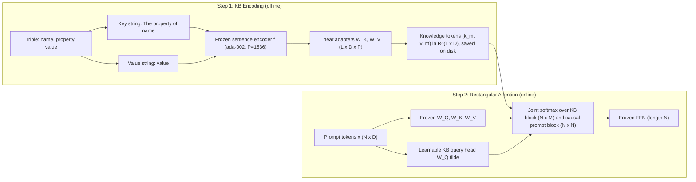

# KBLaM: Knowledge Base augmented Language Model — 연구 분석 보고서

> **논문 정보**
> - **저자**: Xi Wang, Taketomo Isazawa, Liana Mikaelyan, James Hensman
> - **arXiv**: [2410.10450](https://arxiv.org/abs/2410.10450) (2024-10-14), ICLR 2025 게재(triage 정보 기준)
> - **코드/데이터**: https://github.com/microsoft/KBLaM/
>
> **표기 규칙**: 그래프에서 눈으로 읽은 수치는 `~`로 표시한 근사치입니다. 논문 본문에 명시된 수치는 근사 표시 없이 적었습니다.

---

## 1. Overview

**KBLaM**은 외부 지식을 pre-trained LLM에 넣는 방법입니다. LLM의 가중치는 **완전히 고정(frozen)**한 채로 둡니다.

**동작 방식**
- 문서 corpus에서 만든 Knowledge Base(KB)의 각 triple `(<name>, <property>, <value>)`를 **knowledge token** 하나로 바꿉니다. knowledge token은 연속 key-value vector pair입니다(p.2, p.4 Eq. (4)–(7)).
- 이 변환에는 pre-trained sentence encoder(OpenAI `ada-002`, $P=1536$)와 학습 가능한 linear adapter를 씁니다(p.8).
- 만든 knowledge token은 **Rectangular Attention**을 통해 모든 attention layer에 주입됩니다(p.5–6, Eq. (9)–(10)).

**주요 특징**
- **외부 retriever가 없음**: RAG와 달리 별도 검색 모듈 없이 end-to-end로 동작합니다.
- **선형 확장**: ICL은 비용이 KB 크기 $M$에 대해 quadratic하게 늘지만, KBLaM은 **linear**하게 늡니다.
- **규모**: context window가 8K인 Llama3 8B Instruct에 **10K개 이상의 triple**을 **A100 80GB 한 장**으로 넣을 수 있습니다(p.1).
- **동적 갱신**: fine-tuning 없이 KB를 추가·수정·삭제할 수 있습니다(p.2, p.6).
- **해석 가능성**: attention score를 보면 모델이 어떤 triple을 근거로 썼는지 알 수 있습니다(Fig. 4, p.7).

---

## 2. Background

LLM에 외부 지식을 더하는 기존 방법은 크게 세 가지입니다(p.1–2, Fig. 1).

| 방법 | 동작 방식 | 장점 | 한계 |
|---|---|---|---|
| **Supervised Fine-tuning** (예: `LoRA`) | 지식을 가중치에 직접 학습 | 추론 시 추가 비용 없음 | 지식이 바뀔 때마다 재학습해야 함. catastrophic forgetting 위험(p.1) |
| **Retrieval-Augmented Generation (RAG)** | 별도 retriever가 고른 top-k chunk를 prompt에 이어 붙임 | 짧은 context로 큰 corpus를 다룰 수 있음 | 모듈이 분리된 pipeline이라 end-to-end가 아님(p.1) |
| **Long-context In-Context Learning (ICL)** | corpus 전체를 context에 넣음 | pipeline이 단순함 | Self-Attention 비용이 quadratic. attention 해석과 KV Cache 동적 갱신이 어려움(p.2) |

**표준 Self-Attention의 비용**
- 길이 $N$인 sequence에서 시간 $O(N^2D)$, 메모리 $O(N^2)$가 듭니다(p.4).
- FFN은 $O(ND^2)$입니다(p.4).

**관련 연구**
- **Structured attention mask**: 서로 독립적인 context끼리 attend하지 않게 막는 연구입니다. Parallel Context Windows(Ratner et al., 2022), Cai et al. (2023), Superposition Prompting(Merth et al., 2024)이 있습니다(p.3).
- **KV Cache**: Pope et al. (2023)의 연구입니다(p.3).
- KBLaM은 위 두 흐름을 KB triple 단위로 끝까지 밀고 간 방법으로 볼 수 있습니다.

---

## 3. Problem

외부 KB를 LLM에 넣을 때 아래 다섯 조건을 **모두** 만족하는 방법이 없었습니다.

1. 외부 retrieval module 없이 **end-to-end**로 동작할 것
2. KB 크기 $M$에 대해 **linear**하게 확장될 것
3. 재학습이나 **KV Cache 전체 재계산 없이** triple 단위로 추가·수정·삭제할 수 있을 것
4. 모델이 어떤 지식을 썼는지 **해석**할 수 있을 것
5. backbone LLM 가중치를 바꾸지 않아 **일반 추론 능력을 보존**할 것

**기존 방법의 구체적 한계**
- **ICL의 메모리 폭증**: triple당 평균 $K$개 token이면 메모리가 $O((KM)^2)$로 늘어납니다(Fig. 3, p.6). 실제로 논문의 ICL baseline은 메모리 제약 때문에 **최대 200 triple**까지만 실험할 수 있었습니다(p.8).
- **KV Cache의 재계산 문제**: causal mask 때문에 context 일부만 바뀌어도 그 뒤의 KV Cache를 전부 다시 계산해야 합니다(p.3, p.6).

---

## 4. Motivation

### 4.1 구조적 착안: Triple 간 독립성

핵심 관찰은 이렇습니다. `<name>`과 `<property>`가 서로 다른 triple은 **독립적인 정보 단위**로 볼 수 있습니다(p.2). 그렇다면 각 triple을 따로 인코딩하고, knowledge token끼리는 서로 attend하지 않게 해도 됩니다.

이 가정 하나에서 다음 성질이 함께 따라옵니다.

- **복잡도**: 메모리는 $O((M+N)N)$, 시간은 $O((M+N)ND)$입니다. $M \gg N$이면 $M$에 대해 linear입니다. 출력 길이가 $N$으로 유지되므로 FFN 비용은 $M$과 무관합니다(p.6).
- **순서 불변성(Permutation invariance)**: knowledge token의 순서가 출력에 영향을 주지 않습니다. 따라서 ICL의 positional bias("Lost in the middle")가 생기지 않습니다(p.6).
- **갱신 용이성**: triple 하나를 바꾸려면 해당 knowledge token 하나만 다시 만들면 됩니다(p.6).
- **해석 가능성**: attention이 일종의 **implicit soft retrieval** 역할을 하므로, 무엇을 근거로 답했는지 직접 볼 수 있습니다(p.3).

### 4.2 학습 측면의 착안: Projection 학습

- 학습 목표는 지식을 가중치에 **암기**하는 것이 아닙니다. **sentence encoder 공간에서 LLM embedding 공간으로 가는 projection**을 찾는 것입니다.
- 따라서 KB의 실제 내용은 중요하지 않으며, **완전히 synthetic한 데이터**로 instruction tuning을 해도 된다는 것이 저자들의 논리입니다(p.2–3, p.7).
- 이 설계는 multi-modal LLM의 instruction tuning(LLaVA, Liu et al., 2023)에서 영감을 받았습니다. KB를 하나의 "modality"로 보는 셈입니다(p.6, p.14).

---

## 5. Contribution

1. **Knowledge Token**
   - 각 triple을 **token 1개 분량의 KV Cache 크기**를 가진 연속 key-value pair로 인코딩합니다.
   - key는 $f(\text{"The <property> of <name>"})$, value는 $f(\text{<value>})$로 만듭니다.
   - layer별 linear adapter $\tilde{W}_K, \tilde{W}_V \in \mathbb{R}^{L\times D\times P}$로 LLM 공간에 사상합니다(p.4, Eq. (4)–(7); Fig. 2a p.5).
2. **Rectangular Attention**
   - prompt token은 이전 prompt token과 **모든** knowledge token에 attend합니다. knowledge token끼리는 attend하지 않습니다.
   - attention matrix 크기는 $(M+N)\times N$입니다.
   - KB를 볼 때 쓰는 query head $\tilde{W}^l_Q$를 새로 학습하며, pre-trained $W^l_Q$로 초기화합니다.
   - $M=0$이면 원래 LLM과 같아집니다(p.5–6).
3. **KB Length Generalization**
   - inference 때 KB 쪽 attention logit에 $\log C - \log M$을 더합니다($C=100$).
   - 학습 때 본 KB(≤100 triple)보다 훨씬 큰 KB에서도 prompt 정보가 KB 항에 묻히지 않게 합니다(p.6, Eq. (11)).
4. **KB Instruction Tuning**
   - 완전 synthetic KB(이름 약 45K개, triple 약 135K개)로 adapter와 query head만 학습합니다.
   - Q&A 유형은 simple, multi-entity, open-ended, unanswerable의 네 가지입니다(p.6–8).
5. **실증 결과**
   - **Emergent retrieval**: 별도 retrieval loss 없이도 15th layer attention이 관련 triple을 정확히 찾아냅니다(Fig. 5).
   - **Q&A 품질**: synthetic data에서 ICL과 비슷한 수준이면서 10K 이상 triple로 확장됩니다(Fig. 6).
   - **Hallucination 억제**: unanswerable 질문을 거절하는 동작을 학습합니다(Fig. 6c).
6. **Ablation Study와 공개 자원**
   - sentence encoder 종류(Fig. 7), 주입 빈도 $K$(Fig. 8), layer별 역할(Fig. 9), latency(Fig. 11)를 분석합니다.
   - 학습·평가용 KB와 코드를 공개했습니다(p.3).

---

## 6. Method

### 6.1 전체 Architecture

- backbone은 **Llama3 8B Instruct**(32 layer, 32 attention head)이며 가중치 $\phi$는 frozen입니다(p.8).
- 전체 과정은 offline **KB Encoding**과 online **Rectangular Attention** 두 단계로 나뉩니다(Fig. 2, p.5).

### 6.2 KB 표현 (Eq. (1), p.3)

$$
\{(\texttt{<name>}_m;\ \texttt{<property>}_m;\ \texttt{<value>}_m)\}_{m=1}^M
$$

- 비정형 문서는 외부 도구로 triple 형태의 KB로 변환합니다.
- `<name>`과 `<property>`는 검색 식별자(key)가 되고, `<value>`는 실제 내용(value)이 됩니다.

### 6.3 Baseline: 표준 Self-Attention (Eq. (2)–(3), p.4)

$$
\mathbf{q}_n^l = \mathbf{W}_Q^l \mathbf{x}_n^l,\quad \mathbf{k}_n^l = \mathbf{W}_K^l \mathbf{x}_n^l,\quad \mathbf{v}_n^l = \mathbf{W}_V^l \mathbf{x}_n^l
$$

$$
\mathbf{y}_n^l = \frac{\sum_{i=1}^n \exp(w_{n,i})\, \mathbf{v}_i^l}{\sum_{i=1}^n \exp(w_{n,i})},\qquad w_{n,i} = \frac{\langle \mathbf{q}_n^l, \mathbf{k}_i^l \rangle}{\sqrt{D}}
$$

### 6.4 Knowledge Token Encoding (Eq. (4)–(7), p.4)

**Base embedding** (frozen encoder $f$, $P=1536$):

$$
\mathbf{k}_m = f(\text{The }\texttt{<property>}_m\text{ of }\texttt{<name>}_m) \in \mathbb{R}^P,\qquad \mathbf{v}_m = f(\texttt{<value>}_m) \in \mathbb{R}^P
$$

**Linear adapter**를 거쳐 layer별 KV 공간으로 사상합니다.

$$
\tilde{\mathbf{W}}_K,\ \tilde{\mathbf{W}}_V \in \mathbb{R}^{L \times D \times P}
$$

$$
\tilde{\mathbf{k}}_m = [\tilde{\mathbf{k}}_m^1, \dots, \tilde{\mathbf{k}}_m^L]^\top = \tilde{\mathbf{W}}_K \mathbf{k}_m \in \mathbb{R}^{L \times D},\qquad
\tilde{\mathbf{v}}_m = \tilde{\mathbf{W}}_V \mathbf{v}_m \in \mathbb{R}^{L \times D}
$$

- **역할 분리**: key는 "무엇에 관한 정보인가"라는 identifier 역할을, value는 실제 content를 담습니다(p.2).
- **고정 크기 출력**: 입력 문장 길이와 상관없이 출력은 고정된 $D$ 차원입니다. 그래서 기존 attention 계산에 그대로 끼워 넣을 수 있습니다(Fig. 2a caption).
- **초기화와 사전 계산**: adapter는 random으로 초기화합니다. base embedding은 학습 효율을 위해 offline으로 미리 계산해 둡니다(p.8).
- **저장량**: KB 전체는 $M \times L \times D \times 2$ 크기의 tensor로 disk에 저장됩니다(Eq. (8)).

### 6.5 Rectangular Attention (Eq. (9)–(10), p.5)

$$
\tilde{\mathbf{y}}_n^l = \frac{\displaystyle\sum_{m=1}^M \exp(\tilde{w}_{n,m}^l)\, \tilde{\mathbf{v}}_m^l + \sum_{i=1}^n \exp(w_{n,i})\, \mathbf{v}_i^l}{\displaystyle\sum_{m=1}^M \exp(\tilde{w}_{n,m}^l) + \sum_{i=1}^n \exp(w_{n,i})}
$$

$$
\tilde{w}_{n,m}^l = \frac{\langle \tilde{\mathbf{q}}_n^l, \tilde{\mathbf{k}}_m^l \rangle}{\sqrt{D}},\qquad \tilde{\mathbf{q}}_n^l = \tilde{\mathbf{W}}_Q^l \mathbf{x}_n^l
$$

**Tensor flow** (layer $l$, 입력 $\mathbf{x}^l \in \mathbb{R}^{N\times D}$):

1. **Prompt 경로(frozen)**: $\mathbf{Q}, \mathbf{K}, \mathbf{V} \in \mathbb{R}^{N\times D}$를 계산합니다.
2. **KB 경로(learnable query)**: $\tilde{\mathbf{Q}} = \mathbf{x}^l\tilde{W}^l_Q$를 계산하고, 저장해 둔 $\tilde{\mathbf{K}}^l, \tilde{\mathbf{V}}^l \in \mathbb{R}^{M\times D}$를 불러옵니다.
3. **Score 계산**
   - KB 블록: $\tilde{\mathbf{Q}}\tilde{\mathbf{K}}^{l\top}/\sqrt{D} \in \mathbb{R}^{N\times M}$. mask가 없습니다.
   - prompt 블록: $\mathbf{Q}\mathbf{K}^\top/\sqrt{D} \in \mathbb{R}^{N\times N}$. causal mask를 적용합니다.
4. **Joint softmax**: 두 블록을 이어 붙인 $N\times(M+N)$ 행렬에 행별 softmax를 적용한 뒤, $[\tilde{\mathbf{V}}^l; \mathbf{V}]$와 곱합니다. 결과는 $\tilde{\mathbf{y}}^l \in \mathbb{R}^{N\times D}$입니다.
5. **FFN(frozen)**: 입력 길이가 $N$으로 유지되므로 FFN 비용은 $M$과 무관합니다.

**설계상 성질**
- **Prompt만 query를 가짐**: knowledge token에는 query가 없으므로 knowledge token끼리 서로 독립입니다(p.6).
- **KB 전용 query head**: KB를 볼 때 별도의 $\tilde{W}^l_Q$를 쓰므로, 원래 self-attention 경로는 건드리지 않고 KB 검색용 query만 학습합니다(p.5, p.8).
- **원래 모델과의 호환성**: $M=0$이면 Eq. (3)과 정확히 같아집니다(p.6).
- **Cross-attention과의 차이**: cross-attention은 Eq. (9)에서 $M$에 대한 합만 남긴 형태입니다. KBLaM은 KB 항과 prompt self-attention 항을 **하나의 softmax 안에서 함께 정규화**합니다. 또 CEPE(Yen et al., 2024)처럼 새 layer를 추가하지 않고 기존 self-attention layer를 수정합니다(p.6, p.14).

### 6.6 KB Length Generalization (Eq. (11), p.6)

$$
\tilde{w}_{n,m}^l = \log C - \log M + \frac{\langle \tilde{\mathbf{q}}_n^l, \tilde{\mathbf{k}}_m^l \rangle}{\sqrt{D}}
$$

- **문제**: 학습 때는 수렴을 위해 KB 크기를 **10–100 triple**로 제한해야 했습니다. 저자들은 이 제한이 "crucial"했다고 씁니다(p.8). 그런데 inference에서는 $M$이 10K를 넘습니다. KB 쪽 score들이 비슷한 크기라면 Eq. (9)의 KB 항이 $M$에 비례해 커지고, 결국 prompt/question 정보가 묻힙니다(p.6).
- **해법**: KB score에 위의 상수를 더하면 KB 항의 합 전체에 $C/M$을 곱한 것과 같습니다. 그래서 KB가 커져도 KB 부분의 전체 기여도가 학습 때 수준으로 유지됩니다.
- **설정**: $C=100$으로 고정하며, 이는 학습 때 본 최대 KB 크기입니다. 추가 학습이 필요 없는 inference-time trick입니다.

### 6.7 KB Instruction Tuning (Eq. (12), p.6)

$$
\max_{\theta} \log p_{\theta, \phi}(A \mid Q, \text{KB}),\qquad \theta = \left\{ \tilde{\mathbf{W}}_K,\ \tilde{\mathbf{W}}_V,\ \{\tilde{\mathbf{W}}_Q^l\}_{l=1}^L \right\}
$$

**데이터 (p.7–8)**
- GPT로 만든 synthetic KB를 씁니다. 30 object types × 30 idea types × 50 names로 이름 약 45K개, triple 약 135K개입니다.
- 앞의 120K triple은 학습에, 15K triple은 validation에 씁니다.
- property는 `description`, `objectives`, `purpose` 세 가지입니다.
- `<value>`는 `<name>`과 상관이 낮게 **일부러** 만들었습니다. 그래야 답이 LLM의 사전지식이 아니라 KB에서 나옵니다.

**학습 샘플 구성 (p.8)**
- 각 샘플마다 10–100개 triple을 무작위로 뽑아 샘플 전용 KB를 만듭니다. 관련 triple 외의 나머지는 distractor입니다.
- mini-batch 400 = 20 micro-batch × 20 sample입니다.
- micro-batch 비율은 unanswerable 2 : simple 6 : multi-entity 6 : open-ended 6입니다.
- unanswerable 질문의 정답은 *"Sorry, I cannot find relevant information in the KB."*입니다. 이를 통해 refusal 동작을 학습합니다.

**최적화 (p.8, p.16)**
- `AdamW`, learning rate $5\times10^{-4}$에서 cosine decay로 $5\times10^{-6}$까지 내립니다.
- 20K iterations, A100 80GB 한 장, `bfloat16`을 씁니다.
- PEFT(`LoRA` 등)는 쓰지 않고 adapter 전체를 학습합니다.
- 1회 학습에 **약 24–48시간**이 걸립니다.

### 6.8 복잡도 비교 (p.4, p.6)

| 방법 | Time | Memory |
|---|---|---|
| Standard Self-Attention (길이 $N$) | $O(N^2D)$ | $O(N^2)$ |
| ICL (triple당 $K$ token) | $O((KM+N)^2D)$ | $O((KM)^2)$ |
| **KBLaM Rectangular Attention** | $O((M+N)ND)$ | $O((M+N)N)$ |

> [!NOTE]
> **파라미터 수 추정(논문 명시값 아님)**: 논문의 single-head 표기를 Llama3 8B에 그대로 적용하면($L=32$, $D=4096$, $P=1536$) 다음과 같습니다.
> - $\tilde{W}_K$, $\tilde{W}_V$: 각각 약 0.2B
> - $\tilde{W}_Q$: 약 0.54B
> - 합계: **약 0.94B**
>
> 실제 Llama3는 GQA를 쓰므로 KV 차원이 더 작고, adapter도 이보다 작을 수 있습니다.

---

## 7. Experiment

### 7.1 실험 설정 (p.8, Sec. 6.1)

| 항목 | 설정 |
|---|---|
| Backbone | Llama3 8B Instruct (32 layer, 32 head) |
| Sentence encoder | OpenAI `ada-002` ($P=1536$) |
| 학습 | 20K iter, batch 400, AdamW, lr $5\times10^{-4}\rightarrow5\times10^{-6}$, A100 80GB 한 장, bf16 |
| 평가 데이터 | **Synthetic** (학습에 쓰지 않은 validation 15,000 triple), **Enron** (기업 이메일로 만든 OOD KB) |
| Baseline | **ICL** (모든 triple을 flatten해 prompt에 붙임, 최대 200 triple), **Zero-shot** |
| 평가 프로토콜 | 5 random seed × 100 test sample = **500 questions**의 평균 |
| Inference hyperparameter | $C=100$ |

Enron KB는 small LM fine-tuning과 중복 제거 clustering을 거쳐 만들었습니다. 두 데이터셋 모두 `description`, `purpose`, `objectives`를 property로 씁니다.

### 7.2 Interpretability: Attention 시각화 (Fig. 4, p.7)

- 10 triple짜리 toy KB에서 **15th layer**의 attention score(32개 head 평균, 범위 0.0–0.4)를 시각화했습니다.
- 단일/다중 entity 질문에서는 해당 KB index(item 2, item 8, items 4·6)에 attention이 집중됩니다.
- KB와 무관한 질문에서는 attention이 특정 triple에 몰리지 않고 전반적으로 낮게 퍼집니다.

### 7.3 Emergent Retrieval 정확도 (Fig. 5, p.9)

15th layer의 head 평균 attention score를 triple별 classification score로 쓰고, Simple Q&A로 평가했습니다. 수치는 모두 그래프 판독 근사치입니다.

| 데이터 | Top-1 Acc (≤$10^2$ → $10^4$ triple) | Top-5 Acc (≤$10^2$ → $10^4$ triple) |
|---|---|---|
| Synthetic | ~0.95+ → ~0.70–0.75 | ~0.95–1.00 → **~1.00 근처 유지** |
| Enron (OOD) | ~0.85–0.90 → ~0.40 | ~0.95 → ~0.65–0.70 |

- 이 결과는 **별도 retrieval objective나 attention regularization 없이** 얻은 것입니다(p.9).
- **BM25와 비교(Fig. 10, p.15–16)**
  - Synthetic: top-5는 비슷하고 top-1은 조금 낮습니다.
  - Enron: BM25와의 격차가 더 커집니다.
  - 이름을 바꾼 **perturbed** 질문: 모든 KB 크기에서 BM25보다 우수합니다.

### 7.4 Q&A 품질 (Fig. 6a/b, p.10)

**(a) BERT Score (F1)**: simple 및 two-entity Q&A

| 데이터 / 유형 | KBLaM (≤$10^2$ → $10^4$) | ICL (≤200) | Zero-shot |
|---|---|---|---|
| Synthetic, one entity | ~0.91–0.92 → ~0.75 | ~0.96–0.97 | ~0.62 |
| Synthetic, two entities | ~0.90 → ~0.80 | ~0.90 | ~0.60 |
| Enron, one entity | ~0.67–0.68 → ~0.62–0.63 | (생략*) | ~0.60 |
| Enron, two entities | ~0.67–0.68 → ~0.59–0.60 | (생략*) | ~0.50 |

\*ICL은 학습 과정이 없어 두 데이터셋에서 결과가 같다는 이유로, Enron 그래프에서는 생략되었습니다.

**(b) GPT-4 Score (0–5)**: open-ended Q&A, 5 seed의 mean ± standard error

| 데이터 | KBLaM (≤$10^2$ → $10^4$) | ICL (≤200) | Zero-shot |
|---|---|---|---|
| Synthetic | ~4.5 → ~2.5–2.7 | ~4.5–4.7 | < 1.0 |
| Enron | ~2.5–3.0 → ~1.7–2.0 | ~4.0–4.3 | ~2.0–2.2 |

> [!WARNING]
> **Enron open-ended 결과**: KBLaM은 **ICL보다 확실히 낮습니다**. KB가 커지면 Zero-shot 수준(~2.0) 또는 그 아래까지 떨어집니다. 따라서 "OOD에서도 Zero-shot보다 낫다"는 주장은 소규모 KB에서만 뚜렷합니다.

### 7.5 Unanswerable 질문과 Hallucination (Fig. 6c, p.9–10)

- **설정**: 질문 100개 중 20개가 unanswerable입니다(positive class). 나머지 80개는 answerable입니다.
- **Recall**: KBLaM은 1,000 triple까지 ~0.85로 거의 일정합니다. ICL도 200 triple까지 ~0.85–1.0을 유지합니다. 즉 KB가 커져도 hallucination이 늘지 않습니다.
- **Precision**: KB가 커질수록 answerable 질문까지 거절하는 **over-refusal**이 생깁니다.
  - KBLaM: ~0.95에서 1,000 triple 시점 ~0.35로 떨어집니다.
  - ICL: 200 triple이 되기 전에 이미 0.6 아래로 급락합니다.
  - 즉 KBLaM 쪽이 훨씬 완만하게 떨어집니다.

### 7.6 Ablation Study와 효율 (Appendix, p.14–17)

| 실험 | 결과 |
|---|---|
| **Sentence encoder** (Fig. 7) | `all-MiniLM-L6-v2`($P$=384), `all-mpnet-base-v2`(768), `ada-002`(1536), `text-embedding-large`(3072)를 비교. embedding 차원과 capacity가 클수록 성능이 좋음 |
| **주입 빈도 $K$** (Fig. 8) | $K=3$: BERT score는 비슷하지만 refusal precision이 떨어짐. $K=10$: refusal 답변을 아예 생성하지 못함. KB 관련 memory/compute는 약 $1/K$로 줄어듦 |
| **Layer별 역할** (Fig. 9) | 초기 layer에서는 $\mathrm{Var}_m[\tilde{\mathbf{k}}^l_m]$가 거의 변하지 않음. 저자들은 초기 layer의 knowledge token이 "KB를 어떻게 쓰라"는 **soft instruction prompt** 역할을 하고, 후기 layer가 실제 지식을 전달한다고 해석함(p.16) |
| **Latency/Memory** (Fig. 11, p.17) | 비교 대상은 retriever overhead가 0인 이상적 RAG가 top-5 triple을 넣는 경우. KBLaM의 memory는 **512 triple**에서 이 RAG와 비슷해지고, token generation은 모든 KB 크기에서 더 빠름 |

---

## 8. Limitation

1. **1-token 압축에 따른 정보 손실**
   - 고유명사나 수치를 원문 그대로 재현하기 어렵습니다(p.10 Sec. 8).
   - 평가한 property도 `description`, `objectives`, `purpose` 같은 서술형 세 가지뿐입니다(p.7–8).
2. **OOD 성능 저하**
   - Enron에서 retrieval(Fig. 5)과 Q&A(Fig. 6a/b) 성능이 크게 떨어집니다.
   - KB가 커질수록 BM25와의 retrieval 격차가 벌어집니다(p.9–10, p.15).
3. **사전 비용과 의존성**
   - adapter 학습에 1회 약 24–48 GPU-hour가 듭니다.
   - 비정형 문서를 triple로 추출하는 별도 pipeline이 필요합니다. Enron의 경우 small LM fine-tuning과 clustering을 썼습니다(p.4, p.8, p.16).
4. **Triple 독립성 가정에 따른 추론 제약**
   - knowledge token끼리 attend하지 않으므로 multi-hop, multi-step, `Chain-of-Thought (CoT)` 추론을 구조적으로 지원하지 않습니다(p.10, p.17).
5. **휴리스틱 의존과 over-refusal**
   - 학습 KB 크기를 10–100으로 제한해야 했고, 큰 KB로 일반화하는 데는 $\log C - \log M$ shift에 의존합니다(p.6, p.8).
   - KB가 커지면 precision이 떨어집니다(Fig. 6c).
6. **제한된 실험 범위**
   - backbone은 Llama3 8B 하나뿐입니다.
   - ICL과 비교한 구간은 ≤200 triple뿐입니다.
   - 성능이 상용 encoder API에 민감하고, 주입 빈도를 줄이면 instruction following이 무너집니다(p.8, p.14–15).

---

## 9. Takeaways

- **단일 GPU에서 KB를 linear하게 확장**: FFN 비용을 $M$과 분리한 덕분에 8K context 모델에 10K 이상의 triple을 넣을 수 있습니다(p.1, p.6).
- **"KB = modality" 관점**: encoder → adapter → instruction tuning이라는 LLaVA식 recipe를 KB에 적용했습니다. KB 내용과 무관하게 **projection만 학습**하므로 synthetic data로 학습할 수 있습니다(p.3, p.7, p.14).
- **동적 갱신과 positional bias 제거**: triple 단위로 KV를 교체할 수 있고, 순서 불변이라 ICL의 위치 편향이 없습니다(p.6).
- **Attention이 곧 retriever**: instruction tuning만으로 중간 layer(15th)에 retrieval head가 나타납니다. 이는 RAG를 미분 가능하게 내재화한 형태로 해석할 수 있습니다(p.3, p.9).
- **Layer별 기능 분화**: 초기 layer는 soft prompt, 중간 layer는 retrieval, 후기 layer는 지식 전달을 맡는다는 관찰은 이후 adapter 경량화와 선택적 주입 연구의 출발점이 됩니다(p.14–16).
- **실무 적용 범위**: 서술형·설명형 지식에서 "어떤 entity의 무엇"을 묻는 Q&A에는 적합합니다. 반면 **정확한 수치나 고유명사 재현이 필요한 업무**에는 아직 RAG나 ICL이 더 안전합니다.

---

## 10. Critical Analysis

### 10.1 강점

- **우아한 구조적 타협**: KBLaM은 RAG의 모듈 분리와 ICL의 quadratic 비용 사이에서 **"retrieval을 attention 안으로 내재화"**하는 깔끔한 대안을 제시합니다. $M=0$일 때 원래 모델과 같아진다는 보장(p.6)은 안전한 plug-in 성질로서 실용적 가치가 큽니다.
- **설득력 있는 실험 설계**: `<value>`를 `<name>`과 일부러 무관하게 만든 synthetic KB(p.7)는 LLM의 parametric knowledge가 개입하지 못하게 막습니다. 따라서 성능이 KB 활용에서 나왔다는 해석이 타당합니다.
- **해석 가능성의 실증**: Fig. 4–5는 attention score를 진단 도구로 쓸 수 있음을 보여줍니다. 별도 retrieval loss 없이 이 성질이 나타났다는 점이 흥미롭습니다.

### 10.2 약점과 평가 공백

1. **"Linear"는 "sub-linear"가 아님**
   - 모든 query token이 $M$개 knowledge token 전부와 dot product를 계산합니다.
   - 따라서 KB가 수백만 triple 규모로 커지면 결국 top-k나 ANN 같은 sparse selection이 필요합니다. 이 경우 RAG와의 경계가 다시 흐려집니다.
2. **저장 비용이 작지 않음**
   - 논문 표기를 그대로 적용하면 triple당 $L\times 2D$ 값이 필요합니다.
   - 10K triple이면 $10^4\times32\times8192\times2\text{ bytes}\approx 5.2$GB(bf16)입니다. 이는 필자의 추정이며, GQA를 쓰면 줄어듭니다.
   - 따라서 "token 하나 분량의 KV Cache"라는 표현은 원문 token 대비 압축률을 말할 뿐, 절대 비용이 작다는 뜻은 아닙니다.
   - adapter와 query head도 추정상 약 0.94B parameter로, "lightweight"라는 인상보다 큽니다.
3. **Baseline 비교가 불완전함**
   - **RAG와는 Q&A 품질을 직접 비교하지 않았습니다.** latency 비교는 이상적 retriever 가정이고(Fig. 11), retrieval 비교는 부록의 BM25뿐입니다(Fig. 10).
   - Synthetic에서 top-1이 BM25보다 낮고 Enron에서 격차가 더 크다는 점을 보면, **실제 데이터에서 BM25 + top-5 RAG가 KBLaM보다 나을 가능성**을 배제할 수 없습니다.
   - ICL과는 ≤200 triple 구간에서만 비교할 수 있었습니다. 따라서 "ICL과 비슷하다"는 주장은 이 구간에서만 검증되었습니다.
4. **평가 지표가 느슨함**
   - BERT Score와 GPT-4 judge는 semantic 유사도 중심의 지표입니다. 저자들이 인정한 **exact name/수치 재현 문제**(p.10)를 드러내기 어렵습니다.
   - Exact Match나 entity-level F1 같은 엄격한 지표가 없어서 실제 사실 정확도를 판단하기 어렵습니다.
5. **Synthetic → Real 전이가 약함**
   - "KB 내용은 중요하지 않고 projection만 학습한다"는 핵심 논리는 Enron 결과에서 부분적으로만 지지됩니다.
   - 특히 open-ended Q&A에서 KB가 커지면 Zero-shot 수준까지 떨어집니다(Fig. 6b). 학습된 projection이 생성 데이터의 문체와 분포에 과적합되었을 수 있음을 시사합니다.
6. **Over-refusal과 정밀도의 trade-off**
   - 1,000 triple에서 precision ~0.35라는 것은 거절 응답의 약 2/3가 사실 답할 수 있는 질문이었다는 뜻입니다.
   - 즉 KB가 커질수록 모델이 **보수적으로 무너지는** 경향이 있습니다.
   - $C/M$ rescaling은 KB 전체 기여도를 고정할 뿐입니다. 관련 triple의 signal-to-noise가 $M$에 따라 낮아지는 문제는 해결하지 않으며, 이것이 원인 중 하나로 보입니다.
7. **Query 쪽 쏠림 위험**
   - key가 "The <property> of <name>"이고 질문에도 name이 그대로 나오는 synthetic 설정은 **lexical matching만으로 풀기 쉬운 과제**입니다.
   - perturbed 데이터에서 BM25보다 낫다는 결과(Fig. 10b)가 이 우려를 일부 덜어줍니다. 하지만 paraphrase나 간접 지칭 같은 더 어려운 질의는 평가하지 않았습니다.

### 10.3 후속 연구 방향

- **가변 압축률**: triple의 정보 밀도에 따라 knowledge token 수를 조절해 수치·고유명사 손실을 줄입니다(p.10).
- **구조화 attention**: 같은 `<name>`을 공유하는 tree 구조나 `<value>`가 다른 `<name>`으로 이어지는 graph 구조를 반영한 mask를 설계하고, multi-hop/CoT instruction tuning과 결합합니다(p.10, p.17).
- **Real-seeded synthetic data**: 실제 KB를 seed로 써서 OOD gap을 줄이고, property schema를 수치·관계형 데이터까지 넓힙니다(p.9–10).
- **효율화**: open-source encoder를 쓰거나 LLM 기반 compressor와 결합합니다(p.14). 또 layer별 역할 분화(Fig. 9)를 반영해 중간·후기 layer에만 주입하는 등 adapter를 차등 설계합니다.
- **하이브리드 retrieval**: KB 규모가 매우 클 때는 ANN 기반으로 일부 knowledge token만 고른 뒤 rectangular attention을 적용합니다. 이렇게 하면 sub-linear 확장과 end-to-end 해석 가능성을 함께 노릴 수 있습니다.

---

**총평**: KBLaM은 frozen LLM에 대규모 구조화 지식을 KV 수준으로 직접 주입하는 실용적이고 해석 가능한 설계를 보여줍니다. 동시에 그 효용이 **"서술형 지식 + in-distribution + 중간 규모 KB"**에서 가장 뚜렷하다는 점도 분명히 보여줍니다. 실제 서비스에 적용하려면 OOD robustness, 엄격한 factuality 평가, RAG와의 정면 비교가 아직 필요합니다.
